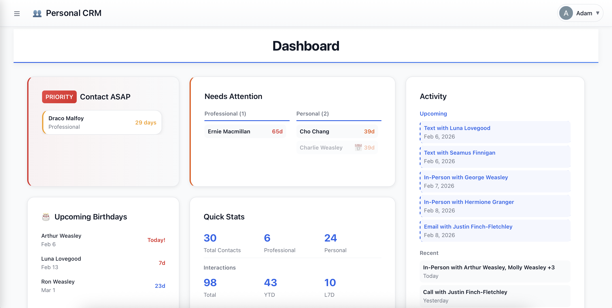

# Personal Relationship CRM

I built this because I kept losing touch with people I cared about. The problem wasn't that I didn't want to stay connected — it was that I had no system. This is a web app that helps you track your relationships and reminds you when it's been too long since you last reached out to someone.

The whole thing is a single HTML file using Firebase for the backend. No framework, no build process, just vanilla JavaScript.

> **[Open the app →](https://personal-crm-31132.firebaseapp.com)** — sign in with Google, your data syncs to the cloud
>
> **[Try the demo →](https://adamst31n.github.io/Personal-CRM/demo.html)** — preloaded with sample data, no account needed



## Features

You add contacts (friends, family, colleagues) and log interactions whenever you talk to them. Each contact has a "cadence goal" — how often you want to stay in touch. The app shows you who you're overdue to contact and keeps a history of all your interactions.

**Core functionality:**
- Contact management with notes, birthdays, and custom cadence goals
- Interaction logging (call, text, email, in-person, video, LinkedIn), including planned future interactions
- Dashboard that surfaces who needs your attention using a color-coded priority system
- Search and filtering across all contacts
- LinkedIn CSV import for bulk onboarding
- Dark mode
- Mobile-responsive design
- Real-time sync across devices via Firebase

**Status system:**
- 🟢 Green — contacted recently
- 🟡 Yellow — getting close to being overdue
- 🟠 Orange — overdue
- 🔴 Red — very overdue
- ⚪ Gray — not yet contacted

## Quick Start

### Option 1: Hosted app (recommended)

**[personal-crm-31132.firebaseapp.com](https://personal-crm-31132.firebaseapp.com)** — sign in with Google and you're ready to go. Data is stored in Firebase and syncs across devices. No setup required.

### Option 2: Demo (no account)

**[Open the demo →](https://adamst31n.github.io/Personal-CRM/demo.html)** — runs entirely in your browser using localStorage. Preloaded with sample contacts so you can explore the interface without signing in. Data does not persist across sessions.

### Option 3: Self-host with your own Firebase project

Use your own Firebase backend instead of the hosted version. You'll need a free Firebase account.

<details>
<summary><strong>Firebase setup instructions</strong></summary>

1. Go to the [Firebase Console](https://console.firebase.google.com/) and create a new project
2. Turn on Authentication with Google as the sign-in provider
3. Create a Firestore database (start in production mode, pick a region near you)
4. Set up security rules so users can only access their own data. Copy the rules from [`firestore.rules`](firestore.rules) into the Rules tab of the Firestore console and publish them.

5. Register a web app in your project settings and copy the config object
6. Download `relationship-crm.html`
7. Open it in a text editor and find the `firebaseConfig` block near the top of the script
8. Replace the values in `firebaseConfig` with your own Firebase config
9. Open in a browser, or run a local server:

```bash
python3 -m http.server 8000
# then visit http://localhost:8000/relationship-crm.html
```

Sign in with Google and you're ready to go.

</details>

## How to Use It

After signing in, you'll see an empty dashboard. Start by adding some contacts.

**Adding contacts:**
Click the + button, fill in their info (only name is required), choose a relationship type (Family, Close Friend, Friend, Professional, or Acquaintance), and set how often you want to stay in touch (default by type, or 14, 30, 60, 90 days, or a custom number of days).

**Logging interactions:**
Every time you talk to someone, log it. Click "Log Interaction" from the dashboard or from a contact's page. Pick the type (call, text, email, in-person, video, LinkedIn), add the date, and write a quick note about what you talked about. You can also tag other people who were there.

**The dashboard:**
Shows you who you need to reach out to. Priority contacts are people you've marked "Contact ASAP". "Needs Attention" lists non-muted contacts who are past their contact frequency. You also see recent activity and upcoming birthdays.

**Keyboard shortcuts:**
| Shortcut | Action |
|----------|--------|
| `Esc` | Close modals |
| `⌘/Ctrl + K` | Search |
| `⌘/Ctrl + N` | New contact |
| `⌘/Ctrl + H` | Dashboard |

**LinkedIn import:**
Export your connections as a CSV from LinkedIn, then upload it in Settings. It is stored as a reference database: when a contact has a LinkedIn URL, the app fills in a blank company and position, and records the connection date. If your value differs from LinkedIn's, the app shows the conflict and lets you choose. Separately, Settings can import a plain contacts CSV.

## Technical Details

This is a single-page app written in vanilla JavaScript. No React, no Vue, no build tools. Just one HTML file with embedded CSS and JavaScript — about 6,200 lines.

**Stack:**
- Vanilla JavaScript (ES6+)
- Firebase Firestore for the database
- Firebase Authentication (Google sign-in)
- All custom CSS, no frameworks

**Architecture decisions:**
- **Single-file design** — Extremely portable. Deploy anywhere that serves static files.
- **Real-time sync** — Firestore `onSnapshot` listeners keep data in sync across devices within milliseconds.

**Data model:**
```
users/{uid}                 (one Firestore document per user)
  contacts[]                (array)
  interactions[]            (array)
  linkedinData[], enrichmentConflicts[], version, lastUpdated
```

Each interaction references a `contactId`. Logging an interaction updates the contact's `lastContactedAt` timestamp, which drives the status colors and sorting.

**Security:**
Firestore rules enforce that a signed-in user can read and write only the document `users/{their own uid}`, and nothing else. A reference copy is in [`firestore.rules`](firestore.rules). The rules live in the Firebase console and are not deployed from this repo.

**Deployment:**
GitHub Pages serves `relationship-crm.html` and `demo.html` from `main`. Firebase Hosting is deployed only with `./deploy.sh`, which publishes just the app file from a temporary `dist/` folder. Never run `firebase deploy` from the repo folder directly.

## Roadmap

Some features I've thought about but haven't built yet:
- Contact photos
- Push notifications (currently you only see reminders when you open the app)
- Google Calendar integration
- Relationship network visualization
- AI-powered outreach suggestions
- Gmail integration
- Custom tags beyond the five relationship types
- Bulk actions

## Known Issues

- Phone number formatting only works for US numbers
- Birthday reminders require you to open the app
- LinkedIn CSV format varies by region, so import might not work perfectly for everyone
- Performance may slow down with 1000+ contacts

## How This Was Built

I started this project to learn full-stack development. It began as a simple localStorage app in January 2026 and evolved into a Firebase-backed application when I needed multi-device sync. I used [Claude](https://claude.ai) as a development partner throughout the process — for debugging, architecture decisions, and learning JavaScript patterns. The project has been my daily driver for tracking relationships ever since.
